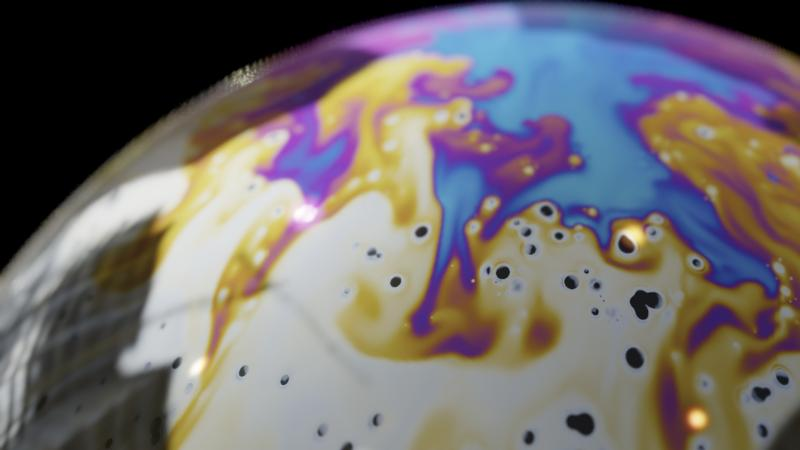

# Light in Motion

A real-time soap-film simulation in WebGPU. A thin-film thickness field flows
over a bubble, and its interference colours are rendered with reflections of a
room, lamps and depth of field.



## Features

- **Thickness field.** One thickness field is advected by Marangoni flow,
  gravity drainage and optional buoyant plumes. It keeps the classic order:
  thick blue at the top, a gold band, and silver near the bottom.
- **Black film spots.** Each spot is a particle with a radius. Spots push apart
  on contact and never merge, attract each other mildly, and join with a smooth
  union. Each spot fades in, and when it dies it swirls back into the
  surrounding film.
- **Light droplets.** Thicker droplets drift through the film.
- **Plumes.** Buoyant columns pulse up along meridians from the Plateau border.
- **Controls.** Moods (Default, Calm, Storm, Plumes), help tooltips, and PNG
  capture.

## Running

You need a browser with WebGPU, such as a recent Chrome, Edge or Safari.
Serve the folder over HTTP and open `index.html`:

```bash
python -m http.server 8000
```

Then go to http://localhost:8000/.

## Files

| File | Purpose |
| --- | --- |
| `index.html` | The standalone page. Edit this file. |
| `build.py` | Builds `light-in-motion.html` from `index.html`. |
| `light-in-motion.html` | The page body for the Claude artifact viewer. The viewer supplies the document wrapper. |

To rebuild the artifact page after editing `index.html`, run `python build.py`.
